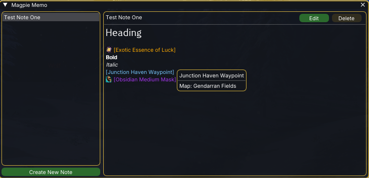
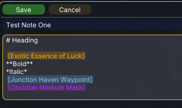
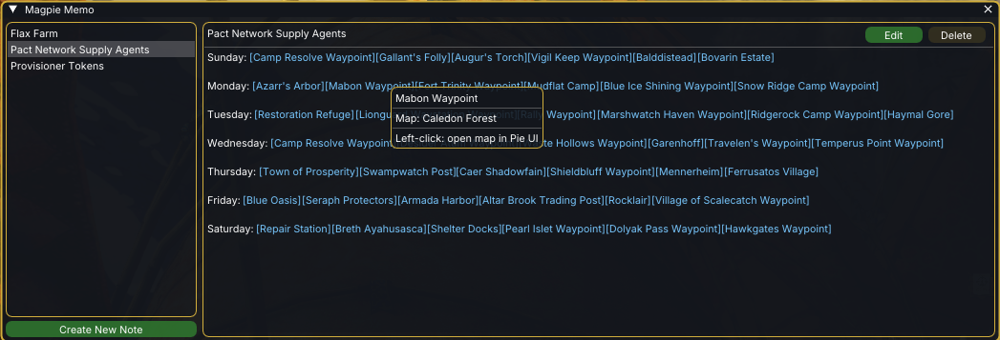

# Trailpack Memo

A notepad addon for Guild Wars 2 (Raidcore Nexus). Keep multiple notes of markdown text with
checklists, GW2 chat links embedded inline as rich "chips" (icon, name and tooltip) and live
event timers, right where you wrote them.

Default toggle hotkey: `CTRL+SHIFT+T`. Data lives in `addons/TrailpackMemo/`.

## Screenshots





## Features

- **Multiple notes**, two-pane: titles on the left, the selected note on the right. Create, rename, and delete.
- **Markdown** in the rendered view: bold, italic, headings, and bullet lists. Edit mode shows the raw source.
- **View / edit modes** with a distinct edit tint, Save / Cancel, and an unsaved-changes prompt so edits are never lost. The editor wraps long lines at the field width (chips move to the next line as a whole).
- **Chat-link chips** — paste any GW2 chat link (waypoint, item, skin, skill, build) into a note and it becomes an inline chip:
  - Shows the item's **icon and name** with a rich hover **tooltip** — item stats, rarity, flavour text and rune/sigil bonuses, skill facts, waypoint map, and full **recipe** breakdowns (ingredients, required rating, and the crafted item).
  - **Right-click** a chip to **Copy chat code** or **Open in wiki**.
  - **Left-click a waypoint chip to open the world map** at that point (needs [Pie UI](https://github.com/PieOrCake/pie_ui); see below).
  - Build links show their spec automatically (e.g. `[Mirage Build]`).
- **Event timers** — pick an event with *Event* in the edit toolbar (search by name or map, or browse
  the categories), type `/e` and a name in the editor (e.g. `/e teq`; arrow keys + Enter or click, Escape
  closes the list), or write `{{event:<id>}}` (e.g. `{{event:tequatl-the-sunless}}`); it becomes a live
  chip: "Tequatl the Sunless - in 23 min" or "- for 4 min" while it runs. Hover for the next starts in
  local time, duration, map and waypoint; left-click copies the waypoint, right-click offers
  *Copy waypoint* / *Open in wiki*. ~90 fixed-schedule events (world bosses, metas, ...), computed
  locally in UTC -- no internet needed. Rotating events (e.g. the Ley-Line Anomaly) are one chip that
  shows the current place while it runs, then the next one.
- **Works with or without [Decoder Ring](https://github.com/PieOrCake/decoder_ring)**: with it loaded, chips show full names and icons; without it, chips fall back to basic labels and the copy / wiki actions still work. Nothing breaks if it loads or unloads mid-session.
- **Optional [Pie UI](https://github.com/PieOrCake/pie_ui) integration**: when Pie UI is loaded, left-clicking a waypoint chip opens and pans the in-game map to that point (Pie UI then lets you click to travel). Without Pie UI the option simply isn't shown; load it any time and it appears, no restart needed.
- **Checkboxes** with GitHub syntax: `- [ ] todo` / `- [x] done` (indentation allowed).
  - Click a box in view mode to tick it -- saved immediately.
  - Checked items are dimmed and struck through; their chips turn into plain grey names (no
    countdown, tooltip or click). Options > "Events" can keep the event countdown (in a
    much lighter event colour) and / or the event chips' tooltips and right-click menus.
  - The note list shows progress (`3/7`, green when complete).
  - Right-click a note body -> **Uncheck all tasks** (handy for daily/weekly routines).
- **Markdown toolbar** in edit mode: **B**, *I*, H1, H2, bullet list, task -- works on the
  selection or the current line(s), and toggles off when applied again. `Ctrl+B` / `Ctrl+I` too.
- **Live preview** beside the editor (`Preview` checkbox, remembered across sessions).
- **Resizable note list**: drag the divider between list and note (double-click resets); long
  titles show in full on hover.
- **Delete several notes at once**: menu button -> *Delete notes...*, tick notes (a group's box
  ticks all its notes, *Select all* / *None*), then confirm.
- **In-game guide**: the *?* next to the window title opens a short guide to every feature
  (English / German).
- **Daily / weekly lists**: give a note the type *Daily* or *Weekly* (right-click -> *Type*, or the
  selector next to the title while editing). Its checkboxes are unchecked automatically after the
  GW2 reset (daily 00:00 UTC, weekly Monday 07:30 UTC) -- also if the game was closed over the
  reset. A coloured *D* / *W* badge marks them in the list; hover for the countdown.
- **Groups**: collapsible groups to structure notes (menu button -> *New group...*, or right-click an empty spot in the list, which
  also offers *Create New Note* and *Delete notes...*). Right-click a
  group to rename, recolour (*Group colour...*), export or delete it (its notes are kept) or add a note to it; move notes via
  right-click -> *Move to group* or by dragging them onto a group; ungrouped notes come first, the groups
  below them (*Layout options* > *Groups above single notes* swaps that); drag a note to an empty spot or use
  *Remove from group* to ungroup it. Groups have unique ids too.
- **Reorder by drag and drop**: drag a note onto another note to put it above or below it (it joins that
  note's group), or a group header onto another one; the order is saved in `notes.json`.
- **Export / import** (menu button next to *Create New Note*): *Export all...* saves every note to one `.json` file, right-click a note ->
  *Export note...* saves just that one; *Import...* shows the notes in such a file (or in a
  plain `notes.json`) and you tick which ones to add; groups come along and are
  matched by id, so an existing group is reused instead of duplicated. Nothing is overwritten,
  and notes you already have are skipped: every note carries a unique id that travels with the
  export (notes without one are matched by identical title + text). If the file holds a
  *different* version of a note you have, you are offered **Update** for it (never pre-selected). Dialogs open in
  `addons/TrailpackMemo/exports/`.
- **English and German UI**: follows the Nexus language by default, or set it in the addon
  options (Auto / English / Deutsch).
- **Custom colours** under "Colour options", grouped as window (border on/off and colour, background, text, menu button and icon), note
  list (border on/off and colour, background, text, group names), note
  (border on/off and colour, background, text), note editor (border on/off and colour; off by default)
  and daily / weekly badges (background and letter, each
  separately, with a live preview). Each row is a swatch that opens a picker with alpha, plus a
  Reset; "Reset all colours" restores every default. Borders are off by default. Popups (menus, tooltips, the event picker, dialogs) are opaque and
  follow the note list's colours by default, so they match the theme; both are settable under "Popups".
- **Themes**: pick *Default (Nexus)*, *Light* or *Dark* under "Colour options" > Theme, or save the
  current colours as your own theme (*Save as theme*; same name overwrites, *Delete theme* removes it).
- **Backup**: settings > "Data: backup and transfer" (at the bottom, apart from the settings): *Create backup...* saves all notes, groups and settings
  (incl. themes) in one `.json` file (default folder `addons/TrailpackMemo/backups/`);
  *Restore backup...* replaces everything with a backup's content after a confirmation.
- **Export / import settings** in the same section: *Export settings...* saves all settings (incl. themes,
  without notes) in one `.json` file, e.g. to share a look or move it to another PC; *Import settings...*
  replaces the settings after a confirmation (a backup file works too, only its settings are used).
- **Settings window**: menu button -> *Settings...* opens the same options as the Nexus addon
  options in a window of its own.
- **Two text sizes** (70-200 %) in the Nexus addon options under "Font options": one for the window's UI, one for the
  note content (view, editor, preview); headings, checkboxes and chips scale along.
- **List row spacing** under "Layout options": space between the rows of the note list, 0-20 px
  (slider plus number field; default 3 px).
- **Corner rounding** under "Layout options": rounding of the note window, its panes, buttons,
  fields, popups and highlighted list rows, 0-12 px (slider plus number field for fine values);
  default 0 = square. Also applies to the settings and guide windows (which otherwise keep
  Nexus's colours, with an opaque background).
- **Lists continue on Enter**: a new `- ` / `- [ ] ` is started automatically; Enter on an empty
  item ends the list.

## Install

Build produces `TrailpackMemo.dll`. Copy it into your Guild Wars 2 `addons` folder. Toggle the window with the quick-access shortcut or `CTRL+SHIFT+T`.

## Building

Part of the [gw2-nexus-addons](../README.md) monorepo -- build from the repository root:

```
cmake -S . -B build && cmake --build build --target TrailpackMemo     # -> build/TrailpackMemo.dll
```

Host-side unit tests for the pure logic (note model, markdown parser, task lists, editing commands, codec, chip round-trip, icon-URL helpers):

```
cmake -S . -B build-host -DGW2_HOST_TESTS=ON && cmake --build build-host && ./build-host/trailpack_host_tests
```

Event timer data (`src/generated/EventData.{h,cpp}`) is generated from the GW2 wiki and API --
don't edit it by hand; fix data in `tools/event_overrides.json` and re-run
`python3 trailpack-memo/tools/gen_events.py` (details in [`plans/EVENTS.md`](plans/EVENTS.md)).

The icon (`icon.png` + `src/generated/EmbeddedIcon.h`) is drawn by `python3 trailpack-memo/tools/make_icon.py`
(standard library only); change the shapes there and re-run it.

## License

MIT -- see [`LICENSE`](LICENSE).
